<!--
  Profile README for github.com/avneets0419
  Custom visuals live in ./assets and are generated by scripts/generate_assets.py.
  Maintenance notes: docs/MAINTAINING.md
-->

<picture>
  <source media="(prefers-reduced-motion: reduce)" srcset="https://raw.githubusercontent.com/avneets0419/avneets0419/main/assets/hero/profile-hero-static.svg">
  
</picture>

  <picture>
    <source media="(prefers-reduced-motion: reduce)" srcset="https://raw.githubusercontent.com/avneets0419/avneets0419/main/assets/hero/typing-static.svg">
    
  </picture>

  &nbsp;
  &nbsp;
  

### About

I work across the stack — Next.js and React Native on the front, Node.js and Python services behind them — and I'm increasingly focused on the AI systems inside the product: LangGraph agents, RAG pipelines that check their own work, and automation that keeps a human in the loop.

- **Now** — FDE Intern at Paramount
- **Previously** — Backend Engineering Intern at smallcase
- **Building** — [Zuplin](https://zuplin.in), a product that helps businesses manage customer relationships, follow-ups and growth
- **Exploring** — agent orchestration, self-correcting retrieval, and scalable backend architecture for intelligent automation

### Selected work

<table>
  <tr>
    <td width="50%" valign="top">
      
      <h4><a href="https://github.com/avneets0419/AI-CRM">AI-CRM</a></h4>
      
A human-in-the-loop CRM prototype. A LangGraph pipeline scores each incoming lead, picks an outreach channel, drafts a first-touch email and explains its reasoning, then pauses until a person approves, edits or rejects it. Every decision is logged.

      
<code>LangGraph</code> <code>Groq</code> <code>FastAPI</code> <code>SQLAlchemy</code> <code>Next.js</code> <code>Tailwind CSS</code>

      
<a href="https://github.com/avneets0419/AI-CRM">Repository</a> · <a href="https://ai-crm-lake-nine.vercel.app">Live demo</a>

    </td>
    <td width="50%" valign="top">
      
      <h4><a href="https://github.com/avneets0419/Self-Correcting-Rag-Agent">Self-Correcting RAG Agent</a></h4>
      
A RAG agent that checks its own work. Retrieved chunks are graded for relevance; weak results trigger a query rewrite and, after two retries, a Tavily web-search fallback. Answers that fail a grounding check are regenerated.

      
<code>LangGraph</code> <code>LangChain</code> <code>Groq</code> <code>FAISS</code> <code>Tavily</code> <code>Streamlit</code>

      
<a href="https://github.com/avneets0419/Self-Correcting-Rag-Agent">Repository</a>

    </td>
  </tr>
  <tr>
    <td width="50%" valign="top">
      
      <h4><a href="https://github.com/avneets0419/Self-optimizing-ad-agent">Self-Optimizing Ad Agent</a></h4>
      
An always-on ad-optimization agent. It writes distinct ad variants from a product description, A/B tests them with a z-test, scales winners only while marginal ROAS holds, rewrites losers, and enforces budget caps, pacing and a stop-loss. Runs on a built-in simulator by default, with Meta and Google Ads adapters.

      
<code>Python</code> <code>Groq</code> <code>Streamlit</code> <code>PostgreSQL</code> <code>APScheduler</code> <code>Plotly</code>

      
<a href="https://github.com/avneets0419/Self-optimizing-ad-agent">Repository</a>

    </td>
    <td width="50%" valign="top">
      
      <h4><a href="https://github.com/avneets0419/News-Credibility-Model">News Credibility Model</a></h4>
      
Real-time fact-checking for news claims. A LangGraph ReAct agent gathers evidence from a ChromaDB index of the LIAR dataset, live NewsAPI coverage and web search, then streams a verdict to the dashboard over SSE. A scikit-learn classifier serves as the traditional-ML baseline.

      
<code>LangGraph</code> <code>Groq</code> <code>ChromaDB</code> <code>FastAPI</code> <code>Streamlit</code> <code>scikit-learn</code>

      
<a href="https://github.com/avneets0419/News-Credibility-Model">Repository</a>

    </td>
  </tr>
  <tr>
    <td width="50%" valign="top">
      
      <h4><a href="https://github.com/avneets0419/Atlas">Atlas</a></h4>
      
A travel-planner app for iOS and Android. Pick a travel mood, swipe through destinations, then open a day-by-day itinerary and map for each trip. Gesture-driven UI with dark mode; itinerary generation is currently simulated with mock data.

      
<code>React Native</code> <code>Expo</code> <code>Reanimated</code> <code>Zustand</code> <code>React Native Maps</code>

      
<a href="https://github.com/avneets0419/Atlas">Repository</a> · <a href="https://youtube.com/shorts/UHnVcMzqhSg">Demo video</a>

    </td>
    <td width="50%" valign="top">
      
      <h4><a href="https://github.com/avneets0419/Ai-Meeting">Ai-Meeting · MeetWise</a></h4>
      
An AI meeting assistant. Upload a recording and it is transcribed with speaker labels, summarized, and turned into action items on a drag-and-drop Kanban board, alongside a meeting calendar.

      
<code>Next.js</code> <code>Express</code> <code>Prisma</code> <code>MongoDB</code> <code>AssemblyAI</code> <code>JWT</code>

      
<a href="https://github.com/avneets0419/Ai-Meeting">Repository</a> · <a href="https://ai-meeting-three.vercel.app">Live demo</a>

    </td>
  </tr>
</table>

### Stack

<table>
  <tr>
    <td><b>LANGUAGES</b></td>
    <td>
      
      
      
      
      
    </td>
  </tr>
  <tr>
    <td><b>FRONTEND&nbsp;&amp;&nbsp;MOBILE</b></td>
    <td>
      
      
      
      
      
    </td>
  </tr>
  <tr>
    <td><b>BACKEND&nbsp;&amp;&nbsp;AI</b></td>
    <td>
      
      
      
      
      
    </td>
  </tr>
  <tr>
    <td><b>TOOLS</b></td>
    <td>
      
      
      
      
    </td>
  </tr>
</table>

### Activity

  
  

  

<picture>
  <source media="(prefers-color-scheme: dark)" srcset="https://raw.githubusercontent.com/avneets0419/avneets0419/output/snake-dark.svg">
  <source media="(prefers-color-scheme: light)" srcset="https://raw.githubusercontent.com/avneets0419/avneets0419/output/snake-light.svg">
  
</picture>

  <a href="https://github.com/avneets0419">github.com/avneets0419</a>
  &nbsp;·&nbsp;
  <a href="https://zuplin.in">zuplin.in</a>
  &nbsp;·&nbsp;
  <a href="mailto:avneet0419@gmail.com">avneet0419@gmail.com</a>

